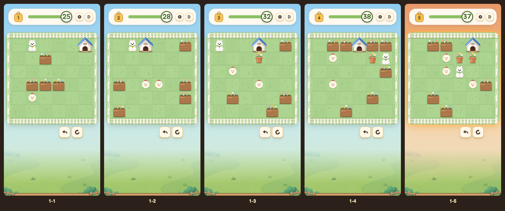

# 1-1 ~ 1-5 「집으로」 시안 (10-12)

1동네 첫 다섯 판을 모두 **개집에 공을 다 넣는 판**으로 다시 짠 시안. 규칙과 개집 그림은 승인된 `home-1-1` 것을 그대로 썼다(`home-engine.js` 는 복사본, 한 글자도 안 바꿨다).
dig.html 은 안 고쳤다 — 미리보기 안에서만 BAKED[0..4] 와 규칙·그림을 얹는 런타임 패치다.

- 미리보기: `http://localhost:8788/docs/superpowers/specs/mock/home-1-5/play.html` (저장소 루트에서 `python3 -m http.server 8788`).
  위 1~5 단추로 판을 고르고, 해답 재생 · 한 수 · 멈춤 · 처음부터, 방향키 그대로. `?lv=3` 이면 3판부터. 세이브는 안 건드린다.
- 검사: `node docs/superpowers/specs/mock/home-1-5/check.cjs` — 게임의 진짜 solve·applyMove 로 59가지(판마다 풀림 · par = 솔버 최소 · 옆/뒤 거절 · 화분 필수 · 걷기 비율).
- 진짜 화면 재생 + 그림: `node docs/superpowers/specs/mock/home-1-5/shots.cjs` — 다섯 판 모두 해답대로 `state=win`.
- 파일: `levels.cjs` 판 원본(글자 그림) → `node build.cjs` → `levels.json` · `home-engine.js` 집 규칙·그림 · `pot-engine.js` 화분 그림 · `sim.cjs` 설계용 빠른 솔버 · `1.png`~`5.png` 시작 화면 · `mid-4.png` `mid-5.png` 풀이 중간.



## 규칙 (바뀐 것 없음) + 화분

- 판에 개집 하나, 문은 아래. 문 앞 칸의 공을 위로 밀 때만 들어가고 못 꺼낸다. 옆·뒤에서는 벽(원래 막힘 연출 + 집이 부르르, 글자 없음). 맥스는 집 칸에 못 선다. 공이 다 들어가면 끝.
- **화분 = 게임에 이미 있는 택배 상자**(`KINDS[1]` = `'log'`, 소리 `boxPush`). 판 데이터에 `b:[r,c,0,1]` 로 놓았을 뿐 규칙은 한 줄도 안 만들었다: 한 칸 밀림, 공과 맥스를 막음, 둘을 한꺼번에 못 밂, 목표가 아님. 집에 안 들어가는 것도 집 패치가 이미 "공만" 받아서 그대로 된다.
  패치는 `drawLog` 를 집 판에서만 토분 그림으로 바꾼 것 하나다(둥근 토분 + 잎 + 꽃 셋, 집과 같은 굵기의 가는 테두리). 화단(네모난 나무 상자, 못 민다)과 모양·크기·색이 다르다.
- 집은 다섯 판 모두 **맨 윗줄**에 세웠다 — 뒤가 울타리라 지붕을 가리는 것이 없고, 맥스가 집 뒤로 돌아갈 일도 없다(가림 순서 문제 없음).

## 판

`#` 화단 · `H` 개집 · `o` 공 · `P` 화분 · `M` 맥스. 좌표는 (줄, 칸), 테두리 울타리가 0.

| 판 | 역할 | 공 | 화분 | par | 걷기 | 아하 |
|---|---|---|---|---|---|---|
| 1 | 학습 | 1 | 0 | 15 | 47% | 공 뒤로 돌아가 밀고, 꺾어서 문 아래에서 위로 |
| 2 | 연습 | 2 | 0 | 18 | 61% | 나란한 두 공 — 문 줄에 선 공부터 |
| 3 | 응용 | 2 | 1 | 22 | 64% | 문 앞 화분을 옆으로 치운다 |
| 4 | 변칙 | 2 | 1 | 28 | 64% | 밀고 나온 화분을 왔던 구멍으로 되민다 |
| 5 | 도전 | 3 | 2 | 32 | 63% | 안쪽 화분을 집 옆으로 올려야 문 앞 화분이 빠진다 |

### 1판 · 학습 — par 15

```
########
#.M...H#     집 (1,6) 구석 · 공 (5,2) — 판이 허락하는 가장 먼 대각
#..#...#
#......#
#.###..#     화단 줄: 공 위에 서서 아래로 미는 실수를 막는다
#.o....#
#......#
########
```
- 해답 `DDLDDRRRRDRUUUU` — 왼쪽으로 돌아 내려가 공 뒤에 서고, 오른쪽으로 네 번, 아래로 돌아 위로 네 번.
- 아하: 미는 쪽은 공 뒤. 방향을 바꾸려면 돌아서 다시 뒤에 선다. 문은 아래에서 위로.
- 막힘 위험: 오른쪽 벽 줄은 집으로 가는 길이라 너무 밀어도 안 막힌다(울타리가 받아 준다). 미는 수 세 번 안에 막히는 건 공을 **왼쪽**으로 미는 것 하나(5,1) — 판 오른쪽으로 크게 돌아가서 반대로 밀어야 한다. (5,5)에서 위로 꺾어도 (2,5)에서 오른쪽으로 다시 풀린다.

### 2판 · 연습 — par 18

```
########
#.MH..##     집 (1,3)
#......#
#......#
##.oo.##     공 둘이 나란히. 양끝 화단은 옆으로 너무 밀어도 받아 주는 범퍼
#.....##
##.....#
########
```
- 해답 `DDDDRUUUDRRDLDLUUU` — 문 줄(3칸)에 선 왼쪽 공을 먼저 위로 세 번, 그다음 오른쪽 공을 그 줄로 한 칸 옮겨 위로 세 번.
- 아하: 한 집에 둘 다 들어간다. 그리고 순서 — 오른쪽 공을 먼저 왼쪽으로 밀면 공 둘이 붙어 안 밀린다(원래 막힘 연출이 알려 준다).
- 막힘 위험: 미는 수 두 번 안에 막히는 것은 공을 **아래로 두 번** 미는 것뿐(집 반대쪽이라 자연스러운 실수가 아니다). 옆으로 미는 실수는 전부 되돌릴 수 있다.

### 3판 · 응용 — par 22

```
########
#M..H.##     집 (1,4)
#...P..#     화분이 문 앞 칸에
#.o....#
#...o..#
#.#...##
#....#.#
########
```
- 해답 `DRRRDRDDLUUULLLDRRDRUU` — 화분을 오른쪽으로 한 칸, 문 줄의 공을 위로 세 번, 왼쪽 공을 오른쪽으로 두 번 밀어 문 줄에 세우고 위로 두 번.
- 아하: 화분은 밀린다. 문 앞 한 칸이 비어야 공이 들어간다.
- 화분 필수: 걷으면 par 18, 화단으로 바꾸면 못 푼다. 공은 화분을 민 뒤에만 들어갈 수 있다.
- 막힘 위험: 왼쪽 공을 왼쪽으로 한 번 밀면 (3,1) 벽 줄에 붙어 끝 — 무르기 한 번. 화분은 어느 쪽으로 치워도 풀린다(왼쪽으로 치우면 걷는 길이 길어질 뿐).

### 4판 · 변칙 — par 28

```
########
#.##H###     집 (1,4), 양옆 화단
#.o..PM#     맥스가 구석 칸에 갇혀 있고 출구를 화분이 막았다
#.....##
#.o....#
#....#.#
#..#...#
########
```
- 해답 `LDLLURDLLLURRDRUDLLLDRRDRUUU` — 화분을 밀고 나오면 화분이 문 앞에 선다 → 아래로 돌아 반대편에서 **도로 구멍으로** 민다 → 윗줄 공을 문 앞으로 두 번 밀어 넣고 → 아랫공을 오른쪽 두 번, 위로 세 번.
- 아하: 3판은 "치워라"였는데 이번엔 내가 민 화분이 문을 막는다. 치울 자리는 방금 나온 구멍이다.
- 화분 필수: 화단으로 바꾸면 맥스가 못 나온다. 걷으면 par 24.
- 막힘 위험: 문 앞에 선 화분을 한 번 더 왼쪽으로 밀면(가장 쉬운 한 수) 윗줄 공과 붙어 둘 다 못 움직인다 — 무르기 한 번이면 풀린다. 이 판의 함정이 곧 이 판의 배움이다.

### 5판 · 도전 — par 32 (험한 판)

```
########
#.##.H.#     집 (1,5) · (1,4)는 빈칸
#..oPP.#     공 · 화분 · 화분이 문 앞에 줄 서 있다
#..oM..#
#....o##
#.#....#
#..#...#
########
```
- 해답 `URDLDDRUUUDDLLLUURRDRULLLDRRDRUU` — 안쪽 화분을 위로(집 옆 빈칸에) → 그 자리에 서서 문 앞 화분을 오른쪽으로 → 문 줄 아랫공을 위로 세 번 → 윗줄 공을 오른쪽 두 번 밀어 넣고 → 남은 공을 오른쪽 두 번, 위로 두 번.
- 아하: 문 앞 화분은 옆 화분 때문에 밀 자리가 없다. 안쪽 화분을 먼저 집 옆으로 올려야 한다. 그다음은 2판(문 줄 공부터)·3판(문 앞 비우기)을 이어 쓴다.
- 화분 필수: 둘 중 어느 하나만 화단으로 바꿔도 못 푼다. 다 걷으면 par 28.
- 막힘 위험: 가운데 공(3,3)을 화분보다 먼저 오른쪽으로 밀면 안쪽 화분을 밀 자리가 사라져 끝. 문 앞 화분을 왼쪽으로 밀어도 끝. 둘 다 무르기 한두 번.

## 정식 반영 때 만들어야 할 것

- **엔진 목표 규칙**: 판 데이터에 `home:[r,c,문]`. `applyMove` 에 "문 앞 칸에서 집 쪽으로 온 공만 들어가 사라진다, 그 밖은 벽"을, `isGoal` 에 "남은 공 0"을 정식 분기로(지금은 원래 함수를 두 번 불러 고르는 덮어쓰기). 들어간 공의 상태 표현(지금은 한 수 동안 집 칸에 남겼다가 다음 수에 뺀다)과 무르기 스냅숏.
- **화분 종류**: 지금은 `'log'` 를 빌려 그림만 바꿨다. 정식으론 `KINDS` 에 `pot` 을 따로 두거나 `log` 의 동네별 스킨으로 — 구덩이를 덮는 것, 물에 젖는 것 같은 상자 전용 규칙이 화분에 따라오면 안 된다. 미는 소리(지금은 골판지), 무거운 짐 미는 맥스 포즈가 화분에 맞는지도.
- **솔버·검수 도구**: 게임 안 `solve` 는 패치된 전역을 타서 그대로 돌지만, `tools/` 의 구이·검수(`stage-ship.js`, par 표, pattern/probe)는 방석 수(`L.holes.size`)를 전제로 한다(공 부족 = 사구 가지치기, par5·도토리 칸).
- **막힘 알림**: 지금 패치는 "벽 구석에 낀 공"만 본다. 벽 줄에 붙은 공, 화분이 문 앞·길을 영영 막은 경우(4판·5판의 함정)는 못 본다 → 솔버 기반 판정이 필요하다.
- **힌트**(다음 한 수·목적지 표시): 방석을 짚는 연출을 문 앞 칸/문으로.
- **판 목록 썸네일·지도**: 방석 대신 집, 상자 대신 화분.
- **도토리(줍는 칸)**: 자리가 판 번호로 박혀 있어 새 판의 화단과 겹친다 — 시안에선 집 판에 안 묻었다(`acornCells` 를 빈 값으로). 2~5판 걸음 목표(par5)도 다시 구워야 한다.
- **다시 만들 첫 안내**(시안에서는 모두 껐다): 방 연습(OB_ROOM, 인형을 방석으로) · 이야기 카드/동네 소개(gintro)의 방석 전제 · 1판 걸음 막대 코치가 방석에 거는 금색 링 · 2판 도토리 코치 · 판 아래 조작 데모(`showHint` base) · 화분 첫 등장 소개(지금 걸리는 건 택배 상자 소개다) · 도착 연출(goalFeel)과 승리 카드의 방석 그림 · 할아버지 게시판 쪽지 문구.

## 패치로 못 한 것 · 걸리는 점

- par 사다리가 제안(15/18/22/25/30)보다 뒤가 길다: **15/18/22/28/32**. 4판은 26수짜리도 있었지만 걷기가 65.4%라 28수짜리를 골랐다.
- 4판은 화단이 8개로 가장 많다(집 양옆 넷 + 맥스 칸 둘레). 구멍·범퍼 구실을 하는 것들이라 줄이면 다른 풀이가 생긴다.
- 화분이 집 옆 윗줄 칸(5판)에 서면 처마와 살짝 겹친다. 집은 물건 층 맨 아래에 한 번 그려서, 집이 윗줄이 아닌 판은 앞줄 다시 그리기가 필요하다(home-1-1 과 같은 제약).
- 1~2판도 공을 벽 줄로 일부러 밀면 막힌다(위 "막힘 위험"). 6×6 판에서 문 하나로는 전부 없앨 수 없었고, 자연스러운 길에서 벗어난 쪽으로만 남겼다.
- 5판은 험한 판이라 들어갈 때 도장 연출이 2초쯤 뜬다 — 첫 실행 안내가 아니라서 그대로 뒀다. 위 걸음 숫자(25/28/32/38/37)는 게임이 par 에서 계산한 제한이다(험한 판은 여유가 적다).
- 1동네 "공"은 닭 인형이라 닭이 개집에 들어간다(home-1-1 과 같다).
- 사람이 직접 해 본 검증은 없다 — 해답 재생과 솔버, 화면 캡처로만 봤다.
